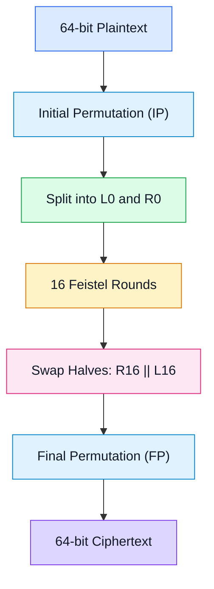
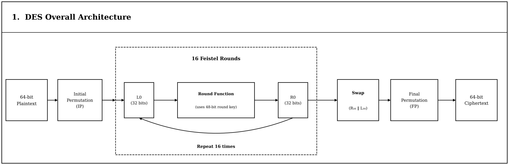
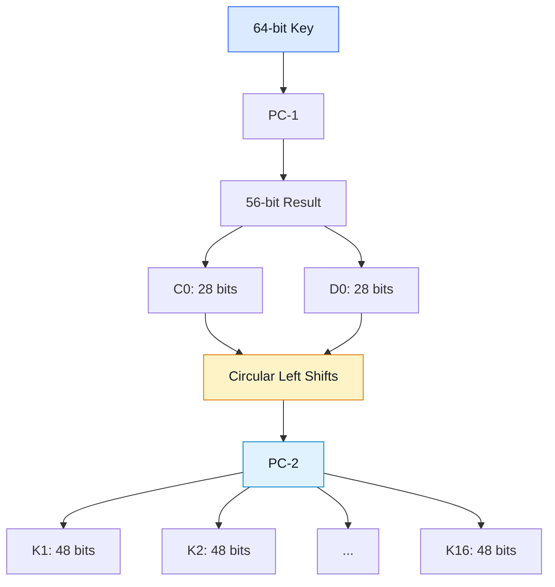
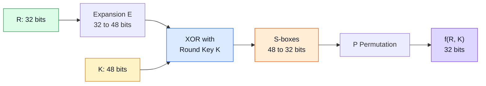
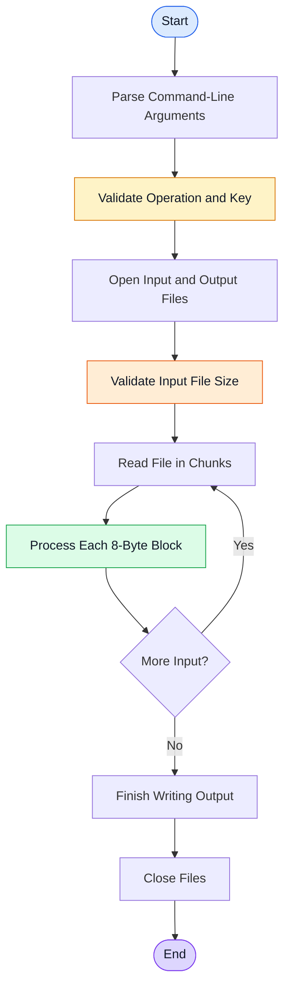
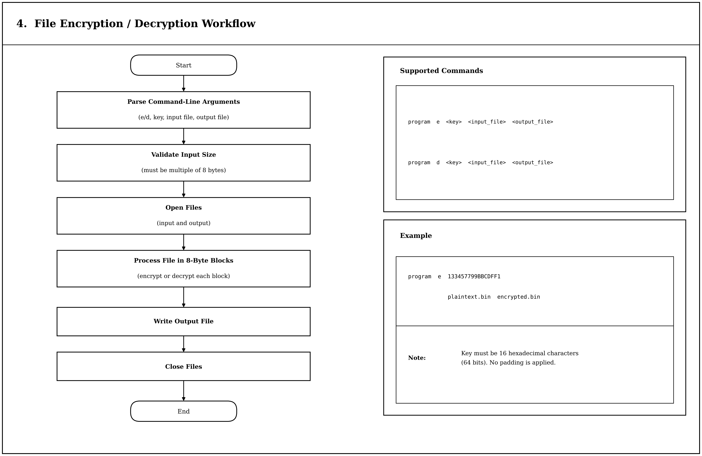

# CipherForge

**A from-scratch implementation of the Data Encryption Standard (DES) in C.**

CipherForge is an educational cryptography project that implements DES at the bit level without relying on external cryptographic libraries. It demonstrates the internal workings of a symmetric block cipher, including key scheduling, permutations, S-box substitution, Feistel rounds, block encryption/decryption, and binary file processing.

The project includes a command-line interface for encrypting and decrypting files, built-in DES known-answer tests, and support for processing large files in chunks.

> **Security warning:** DES is cryptographically obsolete and must not be used to protect sensitive data. CipherForge is intended for educational purposes and algorithm experimentation.

---

## Table of Contents

* [Overview](#overview)
* [Features](#features)
* [DES Architecture](#des-architecture)
* [DES Round Function](#des-round-function)
* [File Encryption and Decryption Workflow](#file-encryption-and-decryption-workflow)
* [Project Structure](#project-structure)
* [Requirements](#requirements)
* [Build and Run](#build-and-run)
* [Command-Line Usage](#command-line-usage)
* [Verification and Test Results](#verification-and-test-results)
* [Performance Benchmark](#performance-benchmark)
* [Current Progress](#current-progress)
* [Limitations](#limitations)
* [Roadmap](#roadmap)
* [Security Disclaimer](#security-disclaimer)
* [License](#license)

---

## Overview

The Data Encryption Standard (DES) is a symmetric-key block cipher that operates on 64-bit data blocks. Its key representation is 64 bits long, but only 56 bits contribute to the effective encryption key; the remaining bits are traditionally used for parity.

DES processes each block through an initial permutation, 16 Feistel rounds, and a final permutation. Decryption uses the same block-processing structure with the round keys applied in reverse order.

CipherForge implements these operations from scratch in C and extends the block cipher implementation with binary file encryption and decryption.

### Technical Specifications

| Property                | Description                         |
| ----------------------- | ----------------------------------- |
| Algorithm               | Data Encryption Standard (DES)      |
| Block size              | 64 bits (8 bytes)                   |
| Key representation      | 64 bits (16 hexadecimal characters) |
| Effective key length    | 56 bits                             |
| Number of rounds        | 16                                  |
| Round-key size          | 48 bits                             |
| File processing         | Chunked binary I/O                  |
| File mode               | Electronic Codebook (ECB)           |
| Padding                 | None                                |
| Implementation language | C                                   |
| Verification            | Five known-answer test vectors      |

---

## Features

* **From-scratch DES:** Implements the DES algorithm without external cryptographic libraries.
* **Bit-level operations:** Performs bit extraction, shifting, XOR, and permutation operations.
* **Initial and final permutations:** Implements the IP and FP transformations.
* **Key scheduling:** Generates 16 round keys using PC-1, circular rotations, and PC-2.
* **Expansion permutation:** Expands the 32-bit right half into 48 bits.
* **Round-key mixing:** XORs the expanded right half with the round key.
* **S-box substitution:** Uses all eight DES S-boxes to transform 48 bits into 32 bits.
* **P permutation:** Rearranges the S-box output bits.
* **Feistel network:** Executes the 16 DES rounds.
* **Block encryption and decryption:** Processes individual 64-bit blocks in both directions.
* **File encryption and decryption:** Reads a binary input file and writes the transformed data to an output file.
* **Chunked file processing:** Processes large files without loading the entire file into memory.
* **Input-size validation:** Rejects files whose sizes are not multiples of 8 bytes.
* **No padding:** Processes complete DES blocks without adding padding.
* **Command-line interface:** Selects encryption or decryption and specifies the key and file paths.
* **Built-in verification:** Includes five DES known-answer tests.
* **Round-trip verification:** Supports checking that decryption recovers the original file.

---

## DES Architecture

DES operates on one 64-bit block at a time. The plaintext passes through an initial permutation, is divided into two 32-bit halves, and enters the 16-round Feistel network.

After the rounds, the halves are swapped and passed through the final permutation to produce the ciphertext.



### DES Architecture Diagram



### Key Schedule

The DES key schedule generates 16 round keys, each 48 bits wide.

1. Apply Permuted Choice 1 (PC-1) to the 64-bit key representation, selecting 56 bits.
2. Divide the result into two 28-bit halves, `C0` and `D0`.
3. Perform circular left rotations according to the DES shift schedule.
4. Apply Permuted Choice 2 (PC-2) to generate each 48-bit round key.



---

## DES Round Function

Each Feistel round uses the current right half and a 48-bit round key to calculate the next right half.

The round function `f(R, K)` consists of four operations:

1. **Expansion:** Expand the 32-bit right half to 48 bits.
2. **XOR:** Combine the expanded result with the 48-bit round key.
3. **S-box substitution:** Divide the 48-bit result into eight 6-bit groups. Each S-box maps one 6-bit group to 4 bits, producing 32 bits in total.
4. **P permutation:** Rearrange the resulting 32 bits.



For round `i`, the Feistel update is:

```text
L(i) = R(i-1)

R(i) = L(i-1) XOR f(R(i-1), K(i))
```

After the 16th round, the halves are combined in reversed order and passed through the final permutation.

### Decryption

DES decryption uses the same fundamental round structure as encryption. The difference is the order in which the round keys are applied:

```text
Encryption: K1, K2, ..., K16
Decryption: K16, K15, ..., K1
```

This allows the original plaintext block to be recovered when the correct key is supplied.

---

## File Encryption and Decryption Workflow

CipherForge accepts an operation, a DES key, an input file, and an output file.

The input is processed in complete 8-byte blocks. The file size must be a multiple of 8 bytes, and no padding is added.



### File Processing Diagram



### File Processing Characteristics

* Input and output files are handled as binary data.
* Large files are processed in chunks rather than loaded entirely into memory.
* Every DES operation processes an 8-byte block.
* Input files that are not a multiple of 8 bytes are rejected.
* No padding is added or removed.
* The key must be supplied in the expected hexadecimal format.

**Important:** ECB mode encrypts each block independently. Identical plaintext blocks encrypted with the same key produce identical ciphertext blocks, which can reveal patterns in the original data. ECB is not appropriate for protecting sensitive real-world data.

---

## Project Structure

```text
CipherForge/
├── 2200284.c    # DES implementation, file processing, and test harness
├── README.md    # Project documentation
├── LICENSE      # MIT License
├── .gitignore   # Git ignore rules
└── docs/
    └── images/
        ├── des-overall-architecture.png
        └── file-encryption-decryption-workflow.png
```

The implementation and built-in test harness are contained in a single C source file.

---

## Requirements

* GCC or MinGW-w64
* Windows PowerShell for the commands shown below
* Standard C library functionality
* Input files whose sizes are multiples of 8 bytes

No external cryptographic libraries are required.

The current file-processing implementation uses `_fseeki64()` and `_ftelli64()` for file-size validation. These are Microsoft-specific functions, so the current implementation should not be assumed to compile unchanged on every operating system or C library.

---

## Build and Run

Open a terminal in the project directory.

### Compile

The following command is the build command verified in the current Windows environment:

```powershell
gcc -B"C:/msys64/ucrt64/bin/" -std=c11 -O2 -Wall -Wextra .\2200284.c -o .\2200284.exe
```

The `-B` option selects the specified tool directory for GCC's subordinate tools in the current environment.

If your GCC installation does not require this workaround, the following standard command may be sufficient:

```bash
gcc -std=c11 -O2 -Wall -Wextra 2200284.c -o 2200284
```

### Run the Built-In Tests

On Windows PowerShell:

```powershell
.\2200284.exe
```

The program runs the built-in DES verification tests and reports whether each known-answer test passes.

---

## Command-Line Usage

The file-processing interface accepts four arguments after the program name:

```text
program e <key> <input_file> <output_file>
program d <key> <input_file> <output_file>
```

Where:

| Argument        | Description                                      |
| --------------- | ------------------------------------------------ |
| `e`             | Encrypt the input file                           |
| `d`             | Decrypt the input file                           |
| `<key>`         | DES key represented by 16 hexadecimal characters |
| `<input_file>`  | Path to the source file                          |
| `<output_file>` | Path to the destination file                     |

### Encrypt a File

Example using the DES key `133457799BBCDFF1`:

```powershell
.\2200284.exe e 133457799BBCDFF1 plaintext.bin encrypted.bin
```

This reads `plaintext.bin` and writes the ciphertext to `encrypted.bin`.

### Decrypt a File

```powershell
.\2200284.exe d 133457799BBCDFF1 encrypted.bin decrypted.bin
```

This reads `encrypted.bin` and writes the recovered plaintext to `decrypted.bin`.

### Verify the Recovered File

Compare the original and decrypted files:

```powershell
fc.exe /b plaintext.bin decrypted.bin
```

If the files are identical, the output includes:

```text
FC: no differences encountered
```

### Input Size Requirements

DES processes 8-byte blocks. The input file size must therefore be divisible by 8.

For example:

* 8 bytes: valid
* 16 bytes: valid
* 100 MiB: valid
* 10 bytes: invalid

CipherForge does not add padding to incomplete blocks.

**Do not encrypt a file over itself unless the implementation explicitly guarantees safe in-place processing.** Use separate input and output paths for the examples above.

---

## Verification and Test Results

CipherForge includes five known-answer tests that compare the computed ciphertext against expected DES results.

| Test | Key                | Plaintext          | Expected Ciphertext |
| ---- | ------------------ | ------------------ | ------------------- |
| 1    | `133457799BBCDFF1` | `0123456789ABCDEF` | `85E813540F0AB405`  |
| 2    | `0000000000000000` | `0000000000000000` | `8CA64DE9C1B123A7`  |
| 3    | `FFFFFFFFFFFFFFFF` | `FFFFFFFFFFFFFFFF` | `7359B2163E4EDC58`  |
| 4    | `133457799BBCDFF1` | `0000000000000000` | `948A43F98A834F7E`  |
| 5    | `133457799BBCDFF1` | `FFFFFFFFFFFFFFFF` | `5A3DB304D64924FD`  |

### Known-Answer Test Result

**Latest recorded result: 5/5 test vectors passed.**

The tests cover different key and plaintext patterns, including all-zero and all-one inputs. The built-in test harness also checks that decryption recovers the original plaintext.

### Large-File Round-Trip Test

A 100 MiB file was used to test file encryption and decryption.

| Check                    | Result                                 |
| ------------------------ | -------------------------------------- |
| Input file size          | 100 MiB                                |
| DES block size           | 8 bytes                                |
| Number of blocks         | 13,107,200                             |
| Encryption               | Completed                              |
| Decryption               | Completed                              |
| Byte-for-byte comparison | Passed for all three decrypted outputs |

The three decrypted files were compared against the original using Windows `fc.exe /b`. All three comparisons reported:

```text
FC: no differences encountered
```

These results establish successful round-trip processing for the tested file and key. They do not replace broader testing of malformed inputs, file errors, or other operating systems.

---

## Performance Benchmark

The following measurements were collected locally using a 100 MiB file and an optimized GCC build.

| Operation  |    Run 1 |    Run 2 |    Run 3 |  Average |
| ---------- | -------: | -------: | -------: | -------: |
| Encryption | 57.999 s | 56.520 s | 45.924 s | 53.481 s |
| Decryption | 25.694 s | 25.279 s | 25.331 s | 25.435 s |

Approximate average throughput:

| Operation  | Average throughput |
| ---------- | -----------------: |
| Encryption |         1.87 MiB/s |
| Decryption |         3.93 MiB/s |

These measurements are specific to the test machine, compiler, executable, and system conditions. They should be treated as preliminary results rather than universal performance figures.

Encryption and decryption have the same number of DES rounds, so the observed performance difference warrants further investigation with repeated controlled benchmarks.

---

## Current Progress

* [x] DES permutation and substitution tables
* [x] Bit extraction and permutation utilities
* [x] 64-bit block loading and storing
* [x] PC-1 and PC-2 key permutations
* [x] 28-bit circular key rotations
* [x] Generation of all 16 DES round keys
* [x] Expansion permutation
* [x] XOR with round keys
* [x] S-box substitution
* [x] P permutation
* [x] DES round function
* [x] 16-round block encryption
* [x] Block decryption using reversed round keys
* [x] Verification against five known-answer test vectors
* [x] Command-line file encryption and decryption
* [x] Input file size validation
* [x] Chunked binary file processing
* [x] Large-file round-trip verification

---

## Limitations

* DES has an effective key length of only 56 bits and is vulnerable to exhaustive key search.
* ECB mode does not hide repeated plaintext blocks.
* Input files must be multiples of 8 bytes.
* No padding is applied.
* The current file-size validation uses Microsoft-specific file-position functions.
* The recorded performance results are specific to one local test environment.
* The current verification suite does not establish comprehensive security or robustness.

---

## Roadmap

Potential future improvements include:

* [ ] Add automated tests for invalid command-line arguments.
* [ ] Test empty files and input files with invalid sizes.
* [ ] Expand file I/O error-handling tests.
* [ ] Investigate the observed encryption/decryption performance difference.
* [ ] Improve portability across operating systems and C libraries.
* [ ] Add reproducible benchmarking instructions.
* [ ] Add a modern authenticated encryption implementation, such as AES-GCM, as a separate feature.
* [ ] Add automated regression testing to the development workflow.

---

## Security Disclaimer

**CipherForge is an educational project and is not suitable for protecting sensitive or real-world data.**

DES is considered insecure because its effective key length is only 56 bits. Additionally, ECB mode reveals patterns when plaintext contains repeated blocks.

For real applications, use a modern, authenticated encryption scheme such as AES-GCM through a well-maintained cryptographic library. Do not use this DES implementation to protect passwords, personal information, financial data, or confidential files.

---

## License

This project is distributed under the MIT License. See the [LICENSE](LICENSE) file for details.
